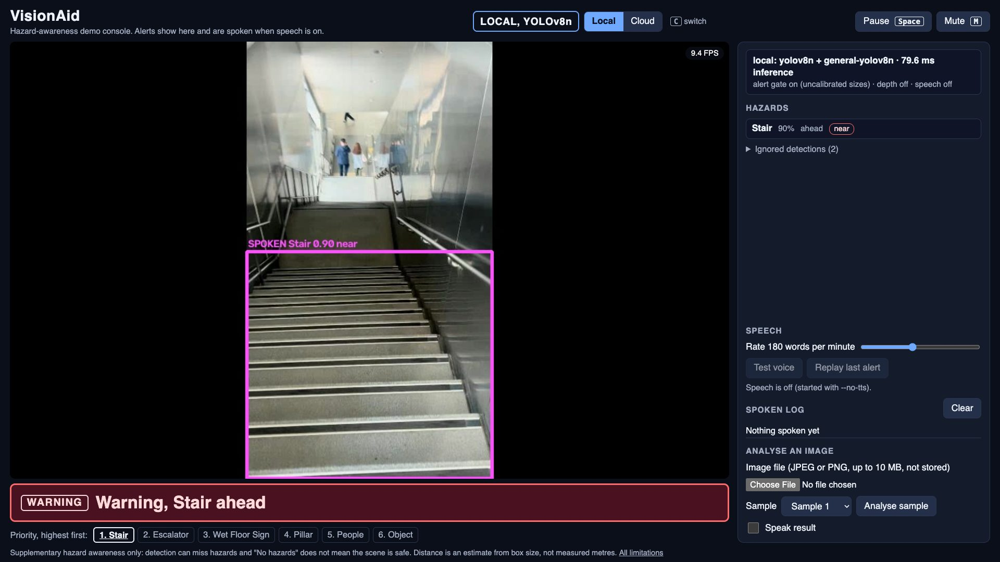
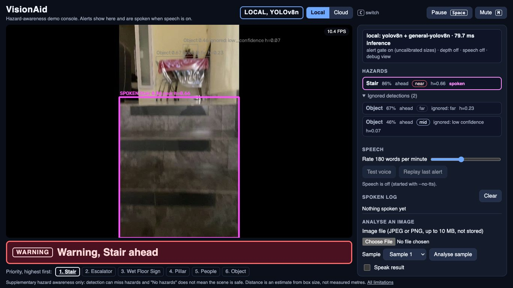
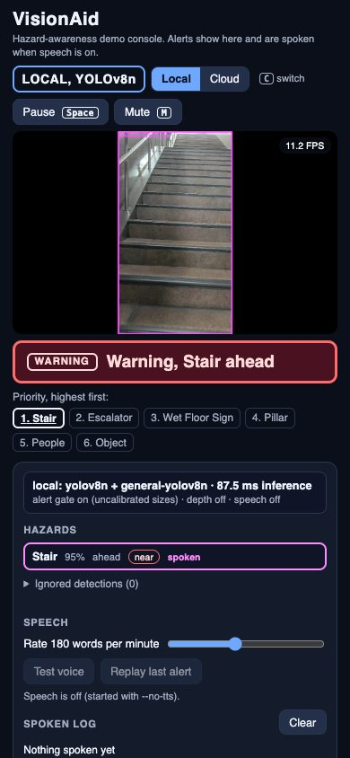

# VisionAid GUI test report

This report covers the GUI hand-over work on Gabriel's branch: the baseline test,
the alert gate, audio alignment, distance bands, the Pillar comparison and the
local versus cloud consistency checks. Each section gives exact commands and outputs.

## Phase A: baseline (before any behaviour change)

### Starting point

- Branch `gabriel`. `git pull --ff-only` brought in one new commit from Gabriel,
  `0ccfe52 Update README` (README only, 23 insertions, 24 deletions).
- Baseline commit: `0ccfe52cabeea3b175e76ecf5fedfbf32582f6bc`.
- Machine: Apple M4, 10 cores, 24 GB RAM, macOS 15.7.9 (arm64).
- Python 3.12.13 in `.venv` (created with `uv venv --python 3.12`; no `python3.12`
  was on PATH). Installed with
  `uv pip install --python .venv/bin/python -r requirements.txt -r requirements-test.txt`.
  On Apple Silicon the non Intel lines apply: Ultralytics 8.4.183, PyTorch 2.15.0,
  OpenCV 5.0.0, NumPy 2.5.4, Flask 3.1.3, ONNX Runtime 1.31.1.
- Docker 29.9.2 (linux/arm64) for the RF-DETR service.
- Weights copied from `~/Downloads/visionaid_pt` to `models/local/yolov8n_v4.pt` and
  `models/cloud/rfdetr-nano_v4.pth` (both git-ignored).

### Roboflow key handling

- The notebooks read `ROBOFLOW_API_KEY` from the environment, then fall back to a
  Kaggle secret of the same name (`kaggle_secrets.UserSecretsClient`). This holds
  for `rf-detr.ipynb`, `yolo11n.ipynb`, `yolo26n.ipynb`, `yolo8s.ipynb` and
  `yolov8n2.ipynb`. `comparecorrect(1).ipynb` does not use Roboflow.
- A search of every tracked file, notebook outputs included, found no key-shaped
  literal in the current tree.
- **The old key is still in git history.** The parent of commit `af3f87c` contains
  `os.environ["ROBOFLOW_API_KEY"] = "<20 characters>"` in the notebooks. Removing
  it from source does not revoke it. A human must revoke it in Roboflow. The value
  was not printed or stored during this work.
- The web app does not need the key. Only dataset download in the notebooks does.

### Automated tests

```
python -m pytest -q
44 passed, 12 subtests passed in 3.69s
```

Gabriel's report said 35 tests and 7 subtests. The suite has grown since.

### Local golden parity

```
python scripts/verify_detector.py --images golden/images \
  --reference golden/expected/local_yolov8n.json --frames 50 \
  --output artifacts/local_golden.json
```

PASS: 20 of 20 reference boxes matched, 0 extras, largest confidence difference
0.00005. Detector benchmark: median 40.4 ms, p95 41.7 ms, 24.7 FPS (CPU).

### Cloud golden parity

Port 9000 on this Mac is taken by a local php-fpm service, so the container was
mapped to host port 9100. Nothing in the app hardcodes 9000.

```
docker build -f cloud/Dockerfile -t visionaid-rfdetr .
docker run -d --name visionaid-cloud -p 127.0.0.1:9100:9000 \
  -v "$PWD/models/cloud:/app/models/cloud:ro" visionaid-rfdetr
curl http://127.0.0.1:9100/health
python scripts/verify_detector.py --runtime cloud --endpoint http://127.0.0.1:9100 \
  --timeout 60 --max-frame-age 60 --images golden/images \
  --reference golden/expected/cloud_rfdetr-nano.json --frames 50 \
  --output artifacts/cloud_golden.json
```

`/health` returned `status: ready`, model `rfdetr-nano`, five classes, input 384,
thresholds 0.40. PASS: 24 of 25 reference boxes, 0 extras (96 percent, the same
as Gabriel's result). Round trip from the client: median 139.5 ms, p95 153.5 ms.

### App smoke test (no camera)

A 40 second, 640x640, 10 FPS clip was made from the 20 golden images (2 seconds
per image) at `artifacts/golden_clip.mp4`. `/status` was polled once a second
for 30 seconds.

```
python src/webapp.py --port 5001 --no-depth --no-tts --source artifacts/golden_clip.mp4
python src/webapp.py --port 5001 --backend cloud --endpoint http://127.0.0.1:9100 \
  --no-depth --no-tts --source artifacts/golden_clip.mp4
```

**Bug found and fixed (blocking):** on the first run every poll returned
`"error": "Camera/source ended"`. `LatestFrameCapture` decoded the video file as
fast as possible, so the whole clip was gone before inference saw it. A camera
delivers frames in real time, but a file does not. The README advertises
`--source /path/to/video.mp4`, so this affected users too. Fix in `src/capture.py`:
file sources are paced at their own frame rate. Camera indices are unchanged.
New test: `tests/test_capture.py`. The fake capture in `tests/test_backends.py`
gained a `get()` method (every real `cv2.VideoCapture` has one).

Results after the fix (logs: `artifacts/status_local.jsonl`, `artifacts/status_cloud.jsonl`):

| | Local | Cloud |
|---|---|---|
| Loop rate | about 10 FPS | about 5 FPS |
| Detector timing | 73 to 120 ms (trained plus general model) | 138 to 145 ms round trip, plus about 55 ms local general model |
| Errors | none | none |

The two runs were not frame-aligned (start-up timing differs), so only a
qualitative comparison is possible here. Phase F does a frame-aligned comparison.
Observed:

- Cloud reported a `Pillar` (0.81) on the first image. Local reported nothing there.
- Cloud found `People` (0.80) on an image where local found nothing.
- Both produced `Object detected on your left` for the same image.
- Every People alert was `Note, People ...` whatever its size, and every trained
  hazard ended with `; distance unavailable` (problem 1 in the hand-over). Small
  background people at 0.39 to 0.40 confidence were announced like near ones
  (problems 2 and 5).

### Old-class and removed-feature search

Searched source, tests, scripts, docs, requirements, templates and notebooks.

| Term | Result |
|---|---|
| bicycle, motorcycle, traffic light, stop sign, fire hydrant, potted plant, couch, suitcase, backpack, houseplant, Open Images, fiftyone, hazard_yolov8n, HAZARD_CLASSES, 16-class lists | No hits. |
| `Chair` | Legitimate: `tests/test_training_dataset.py` uses it as a wrong label that must be rejected; a comment in `tests/test_scene_detector.py` describes a COCO chair. |
| `ocr`, `easyocr` | **Leftovers:** `CLAUDE.md` (lines 26, 55), `README.md` (154, 168, 173, 188), `requirements.txt` (`easyocr`), `scripts/benchmark_pipeline.py` (excludes list). Historical record only: `docs/VERIFICATION.md`, `docs/verification_results.json`. |
| `voice`, `SpeechRecognition`, `pyaudio`, `speech_recognition` | **Leftovers:** `requirements.txt` (`SpeechRecognition` and a comment), `requirements-voice.txt`, README voice sections, `CLAUDE.md` line 55. No code imports them. |
| `--no-ocr`, `--no-voice`, `--no-product-id`, `--mic-index` | **Leftovers:** dead flags in `src/webapp.py`, `src/live_pipeline_demo.py` and README commands; `tests/test_pipeline.py` sets `args.mic_index`. |
| `ImageNet`, item ID | **Leftovers:** `CLAUDE.md` lines 26 and 56, `scripts/benchmark_pipeline.py`. |
| `identify_item`, `scan_text` | Legitimate: `tests/test_pipeline.py` asserts those routes return 404. |
| `test.py` | Unrelated sensor plot at the repository root. |

Phase H handles all of these leftovers.

### Not testable here (manual)

Live camera view, audible speech, how alerts feel while walking and the tape-measure
distance test. See `docs/MANUAL_TEST_SHEET.md`.

## Phase B: alert gate

The gate lives in `src/decision_engine.py` as the pure function `assess()`. The web
app, the OpenCV demos (through `PipelineState`) and `scripts/benchmark_pipeline.py`
all call it, and so does the replay tool added in Phase F. Local and cloud
detections go through the same function. The settings are in
`visionaid_config.json` under `alert_gate` and are validated at start-up.
`--no-gate` restores the old announce-everything behaviour for comparison.

Rules, applied to every detection in this order:

1. A general-model detection (`class_id` -1) below `object_min_confidence` (0.5)
   is ignored as `low_confidence`.
2. `size` = box height / frame height. Below the class `min_size` the hazard is
   `far` and is never spoken.
3. Left or right third: Objects are always ignored (`side`). Trained classes need
   `size >= min_size x 1.5`.
4. Band from `size / near_size`: 1.0 or more is near ("Warning"), 0.6 or more is
   mid-close ("Caution"), otherwise mid ("Note"). With depth enabled, the band
   comes from depth only (decision D8: never mixed with box size).
5. Ranking: hazards that pass come first, any trained class before any Object,
   then `severity x (0.5 + 0.5 x proximity)`, where proximity is `min(1, size / near_size)`
   without depth.

A COCO person that no trained box overlaps (IoU < 0.5) becomes a `People`
detection with `class_id` -1 and `source: general` (D5). The cooldown key is now
`(label, position, band)`, 4 s for trained hazards and 8 s for general detections.
A hazard whose proximity rises by more than 0.15 re-alerts early.

Effect on the Phase A clip (local, 30 polls): background people at 0.39 to 0.40
confidence and side objects are no longer spoken. The stair image gives
`Warning, Stair ahead` instead of `Note, Stair ahead; distance unavailable`.

### Where the hand-over and the code disagreed

- The B3 table expects a centred Wet Floor Sign of height 0.20 to say "Note".
  The B1 rule gives 0.20 / 0.28 = 0.71, which is mid-close ("Caution"). The tests
  follow the rule and check both sides of the boundary (0.16 is "Note", 0.20 is
  "Caution").
- B2 says `scene_detector` should apply the Object confidence floor. It is applied
  in the gate instead, so low-confidence objects still reach `/status` and the
  "ignored" list with the reason `low_confidence` (Phase E), and so the rule is
  backend-independent. The floor also applies to general-model People.
- With the placeholder sizes, a side People box that passes the side rule
  (0.40 x 1.5 = 0.60) is already near, so a side person is only ever "Warning".
  Phase D revisits the sizes.

## Phase C: audio and banner alignment

- `AlertPolicy.process()` in `src/decision_engine.py` makes one decision per frame
  (decision D6). The banner is the top gated hazard. The speaker gets the
  highest-priority gated hazard whose cooldown has expired. The spoken hazard
  stays marked as `selected` while the same class and position stay in view.
  Banner, list, highlight and speech all come from the same frame's gated hazards.
- `src/tts.py` `Speaker`: at most one phrase waits. A newer phrase replaces it, a
  playing phrase is never interrupted, and a waiting phrase older than
  `max_pending_age` (default 1.0 s, a constructor argument) is dropped when its
  turn comes. The old queue dropped the newest phrase instead.
- `/status` adds `selected` (class, position, band, source, phrase, box),
  `spoken_at` (Unix time the phrase was handed to the speaker), `gate_enabled`,
  `gate_calibrated`, `depth_enabled` and `tts_enabled`. Each detection adds
  `position`, `size`, `band`, `source`, `gated` (true means it passed the gate),
  `reason` (far, side or low_confidence), `proximity`, `priority` and `phrase`.
  Detections stay in detector order. The original four fields are unchanged.
- `/video_feed` draws gated boxes coloured by band (red near, amber mid-close,
  green mid) and the spoken box in thick magenta with a `SPOKEN` tag.
  `/video_feed?debug=1` also draws ignored boxes in thin grey with their reason
  and size.

Known trade-off: a phrase dropped as stale has already used its cooldown, so that
hazard waits up to 4 s (8 s for Objects) before it is offered again. This only
happens when the speaker is still busy more than 1 s after the phrase was queued.

## Phase D: distance (estimates, not measurements)

### D1. Recall by object size

```
python scripts/recall_by_size.py --images "$BUNDLE/test_set/test/images"
python scripts/recall_by_size.py --backend cloud --endpoint http://127.0.0.1:9100 \
  --timeout 60 --max-frame-age 60 --images "$BUNDLE/test_set/test/images"
```

Outputs: `artifacts/recall_by_size/{local,cloud}/recall_by_size.{csv,md,json}`,
People example sheets `people_{small,large}_{hits,misses}.jpg`, and the prediction
caches `artifacts/{local,cloud}_test_predictions.json`. Overall recall per class
matches the saved notebook values (local People 58%, Pillar 17%, Stair 69%,
Wet Floor Sign 56%, Escalator 90%), which confirms the matching rule.

**How to read size.** A detector sees pixels, not fractions. The test images are
portrait phone frames letterboxed into 640x640, so a test box of height fraction
`s` is `s x 640` model-input pixels. A 1280x720 webcam frame becomes 640x360
inside the model input, so the same pixel height is `640/360 = 1.78` times larger
as a fraction of the webcam frame. The "webcam fraction" column is that
conversion, and it is the unit of `alert_gate.min_size`. Distances use the pinhole
formula `distance = focal_px x real_height_m / box_height_px` with an **assumed**
focal length of 914 px (720p webcam, about 70 degrees horizontal field of view)
and a 1.7 m person. They are estimates. A real camera must be measured
(`docs/DISTANCE_TEST_SHEET.md`).

### Recall by box height, local (yolov8n, thresholds 0.35)

Test box height fraction, model-input pixels, the same pixels as a fraction of a 1280x720 webcam frame, and the estimated distance of a 1.7 m person at that size (focal 914 px). Cells: recall (hits/boxes).

| Test fraction | Input px | Webcam fraction | Person distance (estimate) | Escalator | People | Pillar | Stair | Wet Floor Sign |
|---|---:|---:|---|---:|---:|---:|---:|---:|
| 0.00-0.05 | 0-32 | 0.00-0.09 | 24.3 m to far | - | 0% (0/15) | 0% (0/6) | - | 0% (0/5) |
| 0.05-0.10 | 32-64 | 0.09-0.18 | 12.1 m to 24.3 m | 0% (0/1) | 19% (28/149) | 0% (0/21) | 0% (0/10) | 31% (21/67) |
| 0.10-0.15 | 64-96 | 0.18-0.27 | 8.1 m to 12.1 m | - | 55% (47/85) | 8% (1/12) | 33% (4/12) | 100% (34/34) |
| 0.15-0.20 | 96-128 | 0.27-0.36 | 6.1 m to 8.1 m | 0% (0/1) | 69% (37/54) | 0% (0/9) | 33% (7/21) | 100% (9/9) |
| 0.20-0.25 | 128-160 | 0.36-0.44 | 4.9 m to 6.1 m | 20% (1/5) | 82% (49/60) | 0% (0/15) | 47% (9/19) | - |
| 0.25-0.30 | 160-192 | 0.44-0.53 | 4.0 m to 4.9 m | 25% (1/4) | 88% (29/33) | 9% (1/11) | 71% (12/17) | 100% (1/1) |
| 0.30-0.40 | 192-256 | 0.53-0.71 | 3.0 m to 4.0 m | 100% (15/15) | 80% (41/51) | 50% (6/12) | 69% (22/32) | - |
| 0.40-0.50 | 256-320 | 0.71-0.89 | 2.4 m to 3.0 m | 75% (3/4) | 83% (38/46) | 42% (8/19) | 71% (17/24) | - |
| 0.50-0.60 | 320-384 | 0.89-1.07 | 2.0 m to 2.4 m | 100% (7/7) | 74% (23/31) | 43% (6/14) | 84% (27/32) | - |
| 0.60-0.80 | 384-512 | 1.07-1.42 | cut off by frame | 95% (58/61) | 91% (20/22) | 15% (4/27) | 74% (37/50) | - |
| 0.80-1.00 | 512-640 | 1.42-1.78 | cut off by frame | 95% (57/60) | 83% (19/23) | 0% (0/7) | 89% (63/71) | - |
| all | | | | 90% (142/158) | 58% (331/569) | 17% (26/153) | 69% (198/288) | 56% (65/116) |

Recall floor per class: the smallest size bucket where recall reaches 50 percent, for that bucket and for all larger boxes, with at least 5 boxes. Shown as a test fraction and as the equivalent webcam fraction (the unit of `alert_gate.min_size`):

- Escalator: test 0.30, webcam 0.53 (config min_size now 0.25)
- People: test 0.10, webcam 0.18 (config min_size now 0.4)
- Pillar: no bucket reaches 50 percent (config min_size now 0.35)
- Stair: test 0.25, webcam 0.44 (config min_size now 0.2)
- Wet Floor Sign: test 0.10, webcam 0.18 (config min_size now 0.15)

### Recall by box height, cloud (rfdetr-nano, thresholds 0.40)

Test box height fraction, model-input pixels, the same pixels as a fraction of a 1280x720 webcam frame, and the estimated distance of a 1.7 m person at that size (focal 914 px). Cells: recall (hits/boxes).

| Test fraction | Input px | Webcam fraction | Person distance (estimate) | Escalator | People | Pillar | Stair | Wet Floor Sign |
|---|---:|---:|---|---:|---:|---:|---:|---:|
| 0.00-0.05 | 0-32 | 0.00-0.09 | 24.3 m to far | - | 0% (0/15) | 0% (0/6) | - | 0% (0/5) |
| 0.05-0.10 | 32-64 | 0.09-0.18 | 12.1 m to 24.3 m | 0% (0/1) | 32% (48/149) | 0% (0/21) | 0% (0/10) | 61% (41/67) |
| 0.10-0.15 | 64-96 | 0.18-0.27 | 8.1 m to 12.1 m | - | 55% (47/85) | 17% (2/12) | 25% (3/12) | 97% (33/34) |
| 0.15-0.20 | 96-128 | 0.27-0.36 | 6.1 m to 8.1 m | 0% (0/1) | 87% (47/54) | 0% (0/9) | 33% (7/21) | 100% (9/9) |
| 0.20-0.25 | 128-160 | 0.36-0.44 | 4.9 m to 6.1 m | 40% (2/5) | 95% (57/60) | 20% (3/15) | 58% (11/19) | - |
| 0.25-0.30 | 160-192 | 0.44-0.53 | 4.0 m to 4.9 m | 100% (4/4) | 91% (30/33) | 45% (5/11) | 53% (9/17) | 100% (1/1) |
| 0.30-0.40 | 192-256 | 0.53-0.71 | 3.0 m to 4.0 m | 80% (12/15) | 92% (47/51) | 50% (6/12) | 78% (25/32) | - |
| 0.40-0.50 | 256-320 | 0.71-0.89 | 2.4 m to 3.0 m | 50% (2/4) | 100% (46/46) | 63% (12/19) | 83% (20/24) | - |
| 0.50-0.60 | 320-384 | 0.89-1.07 | 2.0 m to 2.4 m | 100% (7/7) | 97% (30/31) | 50% (7/14) | 88% (28/32) | - |
| 0.60-0.80 | 384-512 | 1.07-1.42 | cut off by frame | 84% (51/61) | 100% (22/22) | 26% (7/27) | 78% (39/50) | - |
| 0.80-1.00 | 512-640 | 1.42-1.78 | cut off by frame | 95% (57/60) | 96% (22/23) | 29% (2/7) | 96% (68/71) | - |
| all | | | | 85% (135/158) | 70% (396/569) | 29% (44/153) | 73% (210/288) | 72% (84/116) |

Recall floor per class: the smallest size bucket where recall reaches 50 percent, for that bucket and for all larger boxes, with at least 5 boxes. Shown as a test fraction and as the equivalent webcam fraction (the unit of `alert_gate.min_size`):

- Escalator: test 0.30, webcam 0.53 (config min_size now 0.25)
- People: test 0.10, webcam 0.18 (config min_size now 0.4)
- Pillar: no bucket reaches 50 percent (config min_size now 0.35)
- Stair: test 0.20, webcam 0.36 (config min_size now 0.2)
- Wet Floor Sign: test 0.05, webcam 0.09 (config min_size now 0.15)

### Operating range: how close must an object be to be recognised?

"Usable" means recall of at least 50 percent from that size upwards. Webcam
distances are estimates for the assumed camera.

| Class | Local YOLOv8n usable from | Cloud RF-DETR usable from | Estimated distance (webcam) |
|---|---|---|---|
| People (1.7 m) | test 0.10, webcam 0.18 (55 to 88 percent above) | test 0.10, webcam 0.18 (87 to 100 percent from 0.15) | about 12 m local, 80 percent or more within about 6 m; cloud 87 percent or more within about 8 m |
| Wet Floor Sign (0.65 m) | test 0.10, webcam 0.18 (100 percent above, few large examples) | test 0.05, webcam 0.09 | about 4.6 m local, about 9 m cloud |
| Stair | test 0.25, webcam 0.44 | test 0.20, webcam 0.36 | no fixed size, so no distance |
| Escalator | test 0.30, webcam 0.53 (only 11 smaller boxes) | test 0.30, webcam 0.53 | no fixed size, so no distance |
| Pillar | never steadily 50 percent; best 42 to 50 percent at test 0.30 to 0.60 | 45 to 63 percent at test 0.25 to 0.60 | no fixed size, so no distance |

### Is a person 1 to 2 m away in the background detected, or only one right in front?

From the data, the model is **not** limited to the person right in front.

- With a 720p webcam, a 1.7 m person needs to be about 2.2 m away to fit in the
  frame at all (`914 x 1.7 / 720`). A person 1 to 2 m away is therefore never "in
  the background": they fill the frame and their box is cut off at the edges. Test
  boxes that tall (test fraction 0.60 or more) are found 83 to 91 percent of the
  time locally and 96 to 100 percent on the cloud model. Most of the misses there
  are crowds, where one predicted box covers two labelled people
  (`artifacts/recall_by_size/local/people_large_misses.jpg`).
- People further back are detected too: locally 80 to 88 percent at about 3 to 6 m,
  55 percent at about 8 to 12 m and 19 percent at about 12 to 24 m. The cloud
  model finds 87 to 95 percent out to about 8 m. Examples:
  `artifacts/recall_by_size/local/people_small_hits.jpg` (small background people
  at confidence 0.36 to 0.65) and `people_small_misses.jpg`.
- This is exactly why the gate is needed. Before Phase B every one of those
  background people was spoken as "Note, People ...". Now a person below 0.40 of
  the frame height (about 5.4 m) is listed as far and stays silent.

### Proposed min_size (not applied)

The recall floor answers "below what size are detections unreliable". It does not
answer "how far away should a hazard be before we speak". The gate needs the
larger of the two. The floors in webcam units compared with the current
placeholders:

| Class | Local floor | Cloud floor | Current `min_size` | Suggestion |
|---|---:|---:|---:|---|
| People | 0.18 | 0.18 | 0.40 (about 5.4 m) | Keep 0.40. It is a speaking-distance choice, well above the floor. |
| Wet Floor Sign | 0.18 | 0.09 | 0.15 (about 5.5 m) | 0.18 (about 4.6 m), the local floor, so both backends speak at the same size. |
| Stair | 0.44 | 0.36 | 0.20 | Keep 0.20. Stairs are the most severe class, and a detected distant stair is still worth an early "Note". Raising to 0.44 would silence stairs until they are close. |
| Escalator | 0.53 | 0.53 | 0.25 | Keep 0.25 for the same reason. The floor rests on only 11 small boxes. |
| Pillar | none | none | 0.35 | Keep 0.35. |

The config is unchanged and keeps `"calibrated": false` until Nigel decides and the
tape-measure sheet is filled in.

Caveats: the test images come from phone cameras held in portrait, not the
deployment webcam. The pinhole conversion assumes one focal length. Box heights of
objects cut off by the frame understate their size.

### D2. Calibration and the debug distance estimate

- `scripts/calibrate_distance.py --camera 0 --class People --distance 3` (or
  `--image`) measures `focal_px = box_height_px x distance_m / real_height_m` and
  appends a sample to the git-ignored `camera_calibration.json`. The app uses the
  median sample. Boxes cut off by the frame are refused.
- When that file exists, `/status` adds `distance_est_m` and `distance_note` to
  People and Wet Floor Sign detections (`src/distance.py`). The estimate is shown
  only in the debug panel, labelled "estimate", and never spoken. Boxes cut off by
  the top or bottom edge get no estimate.
- `docs/DISTANCE_TEST_SHEET.md` is the tape-measure log (1, 2, 3, 5 and 8 m per class).

### D3. Pillar: local versus cloud

```
python scripts/compare_pillar.py --images "$BUNDLE/test_set/test/images" \
  --endpoint http://127.0.0.1:9100
```

All 105 test images with a Pillar label (153 boxes) and all 815 images without
one. Outputs: `artifacts/pillar/pillar_comparison.{md,json}` and contact sheets
`artifacts/pillar/pillar_{local,cloud}_{hits,misses}.jpg`.

| | local (yolov8n, 0.35) | cloud (rfdetr-nano, 0.40) |
|---|---:|---:|
| Pillar boxes (images) | 153 (105) | 153 (105) |
| Recall | 17.0% (26 hits, 127 misses) | 28.8% (44 hits, 109 misses) |
| Precision | 54.2% (22 false of 48) | 51.8% (41 false of 85) |
| Images without a pillar that got a Pillar box | 14 of 815 | 29 of 815 |
| Mean confidence of hits | 0.56 | 0.61 |
| Missed pillars covered by a general Object box (conf >= 0.5, IoU >= 0.5) | 3 of 127 | 3 of 109 |
| Recall, height 0.00-0.05 | 0% (0/6) | 0% (0/6) |
| Recall, height 0.05-0.10 | 0% (0/21) | 0% (0/21) |
| Recall, height 0.10-0.15 | 8% (1/12) | 17% (2/12) |
| Recall, height 0.15-0.20 | 0% (0/9) | 0% (0/9) |
| Recall, height 0.20-0.25 | 0% (0/15) | 20% (3/15) |
| Recall, height 0.25-0.30 | 9% (1/11) | 45% (5/11) |
| Recall, height 0.30-0.40 | 50% (6/12) | 50% (6/12) |
| Recall, height 0.40-0.50 | 42% (8/19) | 63% (12/19) |
| Recall, height 0.50-0.60 | 43% (6/14) | 50% (7/14) |
| Recall, height 0.60-0.80 | 15% (4/27) | 26% (7/27) |
| Recall, height 0.80-1.00 | 0% (0/7) | 29% (2/7) |

Local recall (17.0 percent) matches the saved result exactly. The cloud figure
over HTTP (28.8 percent) is slightly below the saved 29.4 percent because frames
are JPEG re-encoded on the way to the service. The miss sheets show three kinds of
miss: thin bollards and poles labelled Pillar where the model boxed the
neighbouring pole (IoU below 0.5), close-up pillar bases cut off by the frame,
and plain misses. Some "false" Pillar boxes are unlabelled poles.

**What the app does when a pillar is not detected:** it says nothing about it.
The general COCO model has no pillar class. It covered only 3 of 127 local misses
(3 of 109 cloud) with an Object box at confidence 0.5 or more, and that box is
spoken as "Object detected ahead" only if it also passes the gate (centre third,
large enough). No Pillar box does not mean there is no obstacle.

## Phase E: page

`src/templates/index.html`:

- Banner: the top gated hazard, or "No hazards", coloured by that hazard's band.
- Hazards list: one row per gated detection in priority order, with class (marked
  "general model" for COCO people), confidence, position, band, and a magenta
  "spoken" marker on the hazard being announced.
- "Ignored detections" is a collapsed section listing far, side and low-confidence
  detections with their reason.
- `/?debug=1` switches the video to `/video_feed?debug=1` (ignored boxes drawn
  grey), opens the ignored section and adds box size and, once calibrated, the
  distance estimate to each row.
- Status line: backend, model, inference or round-trip time, alert gate on or off
  (and "uncalibrated sizes" while `calibrated` is false), depth and speech state.
- Footer adds "Distance is an estimate from box size, not measured metres." and
  "No hazards does not mean the scene is safe". The em dash in the tagline was removed.

Checked with headless Chrome against the Phase A clip: banner `Warning, Stair ahead`,
the stair box drawn magenta with a `SPOKEN` tag, and the list row marked "spoken".

## Phase F: local versus cloud consistency

```
python scripts/replay_alerts.py --source artifacts/golden_clip.mp4 --stride 5 \
  --output artifacts/replay_local.jsonl
python scripts/replay_alerts.py --source artifacts/golden_clip.mp4 --stride 5 \
  --backend cloud --endpoint http://127.0.0.1:9100 --output artifacts/replay_cloud.jsonl
python scripts/replay_alerts.py --compare artifacts/replay_local.jsonl \
  artifacts/replay_cloud.jsonl --output artifacts/replay_compare.md
```

`scripts/replay_alerts.py` uses the same `SceneDetector` and `AlertPolicy` as the
web app, processes every frame in order (every 5th here, 80 frames, 0.5 s apart)
on a simulated clock and never plays audio, so the two runs line up frame by frame.

Frames: local 80, cloud 80, compared 80

Detections per class (all):
| Class | local | cloud |
|---|---:|---:|
| Escalator | 4 | 8 |
| Object | 36 | 36 |
| People | 40 | 48 |
| People (general) | 35 | 31 |
| Pillar | 0 | 4 |
| Stair | 32 | 32 |
| Wet Floor Sign | 4 | 4 |

Gated detections per class:
| Class | local | cloud |
|---|---:|---:|
| Escalator | 4 | 4 |
| Object | 4 | 4 |
| People | 4 | 8 |
| Pillar | 0 | 4 |
| Stair | 32 | 32 |

Timing (local): latency_ms mean 89, median 78
Timing (cloud): latency_ms mean 207, median 197; round_trip_ms mean 144, median 141
latency_ms includes the local general model; round_trip_ms is the cloud HTTP request alone.

Banner differs on 8 of 80 frames; spoken phrase differs on 2 frames.
Banner differs although both gated the same (class, position, band) set: 0 frames []
Gate re-check on local: all frames reproduce
Gate re-check on cloud: all frames reproduce

| Frame | Time | local banner | cloud banner | local spoken | cloud spoken |
|---:|---:|---|---|---|---|
| 0 | 0.0 | - | Caution, Pillar ahead | - | Caution, Pillar ahead |
| 5 | 0.5 | - | Caution, Pillar ahead | - | - |
| 10 | 1.0 | - | Caution, Pillar ahead | - | - |
| 15 | 1.5 | - | Caution, Pillar ahead | - | - |
| 100 | 10.0 | - | Caution, People ahead | - | Caution, People ahead |
| 105 | 10.5 | - | Caution, People ahead | - | - |
| 110 | 11.0 | - | Caution, People ahead | - | - |
| 115 | 11.5 | - | Caution, People ahead | - | - |

**Verdict.** 72 of 80 frames give the same banner. All 8 differences come from
different detections: on the first image the cloud model finds a Pillar the local
model misses, and on another image it finds a person local misses. These are
expected model differences (see the Pillar comparison in Phase D). No frame
differs where both backends gated the same (class, position, band) set, and
re-running the gate on each file's recorded detections reproduces every frame. No
gate-caused differences were found. Cloud adds about 60 ms per frame over HTTP
on this machine (round trip 141 ms median against local trained-plus-general
78 ms), and cloud mode also runs the general model locally.

## Phase H: cleanup and docs

- `CLAUDE.md` rewritten: OCR, voice and item-ID statements removed; the gate,
  bands, audio policy, general-model People, distance estimate and Roboflow key
  handling are described.
- `README.md`: new "Alert gating: what is spoken and why" section, a distance
  estimate (debug only) note, experimental depth, alert analysis tools, Roboflow
  key instructions (environment variable or Kaggle secret, `.env` ignored, old key
  must be revoked by a human), updated Pillar section with the re-measured
  comparison and what happens on a miss, note on alternative cloud ports, and a
  note that a hosted version would need browser capture (`getUserMedia`). Dead
  flags removed from all commands.
- `requirements.txt`: `easyocr` and `SpeechRecognition` removed (nothing imports
  them). `timm` (MiDaS) and `pyttsx3` (non-macOS speech) kept with comments.
  `requirements-voice.txt` and the unrelated root `test.py` deleted.
- Dead `--no-ocr`, `--no-voice`, `--no-product-id` and `--mic-index` flags removed
  from `src/webapp.py` and `src/live_pipeline_demo.py`, and `mic_index` from the
  pipeline test. Both OpenCV demos run through `PipelineState`, so they already use
  the shared gate and `AlertPolicy`; no logic is duplicated.
- `docs/VERIFICATION.md` gained a note that it is a dated historical record.
- `docs/MANUAL_TEST_SHEET.md` added.

The repeat search for the Phase A terms (outside the historical verification
record and this report) finds only sentences stating that OCR, voice and item
identification were removed.

## Final checks

```
python -m pytest -q                      -> 72 passed, 12 subtests passed
verify_detector.py local golden          -> PASS 20/20, 0 extras
verify_detector.py cloud golden (HTTP)   -> PASS 24/25, 0 extras
benchmark_pipeline.py --no-depth         -> median 46.4 ms, 21.1 FPS (excludes the general model)
```

## Definition of done

| Item | Status |
|---|---|
| Baseline report: what passed, failed and was not testable | Done (Phase A) |
| pytest green with new tests; golden parity unchanged | Done: 72 tests and 12 subtests; 20/20 local, 24/25 cloud |
| Far or off-path detections not spoken, near ones spoken, same code path for local and cloud | Done (Phases B, C, F) |
| Banner, highlighted box and spoken phrase refer to the same hazard | Done (Phase C), checked in headless Chrome (Phase E) |
| Distance as bands; placeholders replaced by data or clearly marked uncalibrated | Bands done. Sizes still placeholders, marked `"calibrated": false` and shown as "uncalibrated sizes" on the page. A data-based proposal waits for Nigel's decision. |
| GUI_TEST_REPORT, DISTANCE_TEST_SHEET, MANUAL_TEST_SHEET exist | Done |
| Report answers Gabriel's three questions with data | Done (Phase D: operating range, background person, Pillar comparison) |
| No leftover OCR, voice, item ID or old-class references; README explains the key | Done (Phase H) |
| Committed on Gabriel's branch, pulled from his latest push, no force push | Done |
| Phase G (in-page Local/Cloud toggle) | Built under the second hand-over (below), Phase 1 |

Not testable here (manual): live camera, audible speech, walking feel, tape-measure
distances, a second device against a hosted endpoint, and revoking the old
Roboflow key. See `docs/MANUAL_TEST_SHEET.md`.

---

# Second hand-over: the interface

Work from `VisionAid_GUI_Handover_2_Interface.md`, on the same branch (`gabriel`;
the hand-over calls it `aai3001_comp-vision-gabriel`, the remote branch is
`origin/gabriel`). `git fetch` showed nothing new from Gabriel before starting.
One commit per phase, pushed normally.

## Decisions applied

| # | Decision | Applied as |
|---|---|---|
| U1 | Wet Floor Sign `min_size` 0.15 to 0.18 | `visionaid_config.json`; no other gate value changed; `calibrated` stays false |
| U2 | After a cloud failure stay on local, Retry cloud button | Yes; no automatic switch back |
| U3 | Default local; clear cooldown on a mode change | Yes, `AlertPolicy.reset()`; also on fallback |
| U4 | JPEG or PNG, at most 10 MB | Yes, checked by content, not by name or declared type |
| U5 | 120 to 260 words per minute, default 180, no volume | Yes (the speaker default moved from 175 to 180) |
| U6 | Space, M, C; ignored in form controls | Yes |

## Phase 1: Local/Cloud switch

- With `--endpoint`, `PipelineState` builds a local and a cloud `SceneDetector`
  sharing one general model. Without it, Cloud is disabled with the reason. The app
  starts local unless `--backend cloud`.
- `POST /mode` switches; cloud is accepted only after the service's `/health`
  returns ready, model `rfdetr-nano` and the canonical class order (no frame is
  sent). The same call is the Retry cloud button. Anything else gets a 400.
- A cloud exception or the existing 3 s deadline falls back to local, sets
  `fallback_active` and `last_error`, and keeps the last good result for at most
  one second after the failure.
- `/status` adds `mode`, `mode_label`, `cloud_available`,
  `cloud_unavailable_reason`, `fallback_active` and `last_error`.
- Page: mode badge, Local/Cloud switch, Retry cloud, and the notice "Cloud mode:
  camera frames are sent to the server."
- Real stack (cloud container on port 9100, recorded clip): switched local to
  cloud (round trip 140 ms), stopped the container (fallback within 2 s, message
  shown), Retry failed while it was down, and succeeded after
  `docker start`.

## Phase 2: runtime error states

`/status` carries `health`, a list of `{code, severity, message}`, shown at the top
of the page. Error-level problems also replace the banner and cover the video,
because "No hazards" would be misleading.

| Condition | Code | Behaviour |
|---|---|---|
| Camera not found or lost | `camera_missing` | Page stays up; the camera is reopened every 2 s and resumes on success. A missing video file still stops the app at startup. |
| Cloud unreachable | `cloud_unreachable` | Phase 1 fallback |
| General model failed to load or predict | `general_unavailable` | Trained detections continue; message "Extra object detection is off." |
| Speech unavailable | `speech_unavailable` | `say` missing, a phrase failing, or the speaker failing to start. The banner keeps working. |
| No frames for 3 s | `no_video` | Results cleared, nothing spoken |
| Video file ended, loop crashed | `source_ended`, `pipeline_stopped` | Plain message instead of a blank page |

Real check: `--source 7` (no such camera) kept the page up with "Camera not found.
Check the connection."

## Phase 3: pause, mute and speech controls

- `POST /control` takes `paused`, `muted`, `rate` and `action` (`test_voice`,
  `replay_last`, `clear_log`). Everything is validated before anything changes;
  wrong types or unknown keys get 400, a speech action while muted or with
  `--no-tts` gets 409.
- Pause: no inference and no speech, the camera stays open, and the last frame
  stays up with a "Paused" label.
- Mute: the speaker now runs `say` as a process it can stop. Mute and Pause
  terminate the current phrase and clear the waiting one. Real check: a long
  phrase stopped after 0.2 s, with no `say` process left.
- Rate: clamped to 120 to 260 and applied to the next phrase.
- Shortcuts are in `src/static/shortcuts.js`, a pure function tested in Node.
  They were also pressed in headless Chrome against the real app. M, Space and C
  toggled mute, pause and mode. M with the rate slider focused and Space with the
  sample list focused did nothing.

## Phase 4: upload and samples

- `POST /analyze` takes a multipart image or a sample id from `GET /samples`.
  There is no `demo/` folder, so the samples are the 20 `golden/images`.
- Live and upload share one path: the active detector, `decide()` and `annotate()`,
  with a fresh `AlertPolicy`, so analysis has its own cooldown.
- The response has the same fields as `/status` plus the annotated image as a
  data URL.
- Upload checks:
  - type by content: Pillow must read it as JPEG or PNG;
  - size: 10 MB exactly, and a body limit as well;
  - at most 40 megapixels;
  - full decode, so a truncated file gives "The file may be damaged".
- The client filename is never used and nothing is written to disk.
- Speak result is off by default and respects mute.
- Real check: all 20 golden images through `/analyze` matched
  `replay_alerts.py --source golden/images` exactly. That covered every detection,
  confidence, gate field and banner.

## Phase 5: legend and spoken log

- `GET /config` serves the priority order from the config severities: Stair,
  Escalator, Wet Floor Sign, Pillar, People, then Object. The legend is built from
  it; the HTML has no class names in the legend.
- The class of the top hazard is marked with a border, an underline and
  `aria-current`, so colour isn't the only signal.
- The banner shows a written level (Warning, Caution, Note) as well as colour.
  Messages are prefixed Problem, Warning or Note.
- `spoken_log`: the last 10 phrases actually sent to the speaker, newest first,
  with time, backend and kind (alert, test, replay, upload). Memory only; Clear
  empties it.

## Phase 6: readability, accessibility and layout

- Contrast: `python scripts/check_contrast.py` checks every colour pair on the
  page, and all 25 pass. Normal text needs 4.5 to 1; the lowest is muted text on
  buttons at 5.8. Large text and indicators need 3 to 1. A test also makes sure
  the stylesheet uses no colour outside the checked tokens.
- Accessibility:
  - the banner is a live region (`role="alert"`, assertive, atomic);
  - all controls are real buttons, inputs or selects with labels;
  - toggles use `aria-pressed`;
  - there's a 3 px yellow focus outline.
- Layout check: `node scripts/check_layout.mjs` drives headless Chrome over the
  DevTools protocol. Run against the real app on the recorded clip, both during
  "No hazards" and during "Warning, Stair ahead":

| Size | Horizontal scroll | Page scroll | Main parts outside the viewport | Root font |
|---|---|---|---|---|
| 1920x1080 | no | no | none | 19.4 px |
| 1366x768 | no | no | none | 16.0 px |
| 1366x768 `?debug=1` | no | no | none | 16.0 px |
| 390x844 | no | yes (allowed, one column) | n/a | 14 px |

"Main parts" are the header, Local, Cloud, Pause and Mute buttons, video, banner,
legend and status card. Hazards, ignored detections and the log scroll inside
their own boxes. Screenshots:





The hand-over says to save screenshots under `artifacts/`, but the first
hand-over says not to commit `artifacts/` (it is git-ignored). The full-size PNGs
are in `artifacts/screenshots/`, and the three referenced here are committed as
compressed JPEGs under `docs/screenshots/`.

## Phase 7: config and docs

- U1 is applied. The gate test now checks that a 0.16 sign is far and a 0.18 sign
  is spoken.
- README: page controls, shortcuts, the cloud privacy notice, fallback and Retry,
  the port 9100 line, and the two page check scripts.
- `CLAUDE.md`: endpoints and `/status` fields.
- `docs/MANUAL_TEST_SHEET.md`: new interface checks.

## Notes and things that differ from the hand-over

- **U1 side effect.** With `min_size` 0.18 and `near_size` 0.28, a gated Wet Floor
  Sign is always at least 0.64 of its near size. So it is never "Note"; it is
  "Caution" or "Warning". This is similar to the side-person case in Phase B.
- **Port line.** `cloud_service.py` has no `--port` option. The README line says
  to use port 9100 through the Docker mapping (`-p 127.0.0.1:9100:9000`).
- **Local weights in cloud mode.** Starting in cloud mode now also loads the local
  model, because it is the fallback. Missing local weights stop the app at startup.
- **Cloud analysis.** In cloud mode an uploaded image goes to the cloud service,
  like camera frames; the privacy notice is shown in that mode.
- **Mute and cooldown.** While muted the cooldown still records the selected
  hazard, so after unmuting the same hazard can wait up to 4 s. Resume after Pause
  does not reset the cooldown; only a mode change does (U3).
- **Test voice and Replay while paused.** They are allowed, since only Mute means
  "no sound".
- Gate logic, phrase wording, cooldown rules, class IDs and the `POST /detect`
  contract are unchanged.

## Tests added

116 tests and 12 subtests pass. That is 72 before, plus 41 in new files and 3 new
speaker tests. The new files share fakes in `tests/helpers.py`.

| File | Tests | Covers |
|---|---:|---|
| `test_modes.py` | 8 | Switch and status; invalid mode; zero cloud calls in local mode (fake, and the real `CloudDetector` with HTTP mocked); fallback with the 1 s hold; retry only on a healthy `/health`; cooldown cleared on switch |
| `test_health.py` | 9 | Camera missing at start and lost while running, both recovering; missing video file still fatal; no video; general model off; speech failing and failing to start; detector errors; general-model failures in `SceneDetector` |
| `test_controls.py` | 6 | Pause stops inference and speech; mute stops speaker calls but not detection; rate clamped and validated; invalid controls; test voice and replay respect mute; speech off |
| `test_shortcuts_js.py` | 2 | 15 key cases in Node, including form controls; the page loads the script and labels the buttons |
| `test_analyze.py` | 6 | Upload matches the live path for the same image; JPEG and PNG; separate cooldown; speak respects mute; wrong type, oversized, truncated and empty files; filename unused and nothing stored; samples by id only; detector failure |
| `test_legend_log.py` | 4 | Legend order follows the config; `/config`; log bounded at 10, matches the fake speaker, newest first, clearable |
| `test_contrast.py` | 3 | Ratio formula; all page pairs pass; no unchecked colours |
| `test_page_a11y.py` | 3 | Labels, real buttons, live banner, `aria-pressed`, focus outline, written states, no dashes |
| `test_tts.py` | +3 | Rate applies to the next phrase; `stop()` ends the playing phrase and clears the waiting one; failures set `error` |

## Final checks (second hand-over)

```
python -m pytest -q                      -> 116 passed, 12 subtests passed
verify_detector.py local golden          -> PASS 20/20, 0 extras (largest confidence difference 0.00005)
verify_detector.py cloud golden (HTTP)   -> PASS 24/25, 0 extras
python scripts/check_contrast.py         -> 25 of 25 pairs pass
node scripts/check_layout.mjs            -> all four sizes pass
```

## Definition of done (second hand-over)

| Item | Status |
|---|---|
| Switch works, falls back safely, never sends frames in local mode | Done; tested with fakes, the real client with HTTP mocked, and the real container |
| Every Phase 2 problem gives a clear message, never a blank page or crash | Done, tested with fakes; the missing camera was also checked on the real app |
| Pause, mute, rate, test voice and replay work and are tested | Done; real `say` stop checked |
| Upload and samples use the live code and match its results | Done; 20 of 20 golden images match the replay pipeline |
| Legend, colours, labels and spoken log, not colour only | Done |
| Contrast and layout pass at three sizes, with screenshots | Done |
| pytest green, golden parity unchanged | Done |
| README, `CLAUDE.md`, this report and the manual sheet updated | Done |
| Committed on Gabriel's branch, no force push | Done |

Not verified here (in `docs/MANUAL_TEST_SHEET.md`):
- audible speech, and mute cutting it off by ear;
- switching modes mid-walk;
- unplugging a real camera;
- reading the page from a distance on the projector;
- whether a marker understands the legend unaided;
- VoiceOver announcing the banner.

---

# Third hand-over: upload demo (images and video)

Source: `VisionAid_GUI_Handover_3_Upload_Demo.md`, suggested by Matthias. The
presenter uploads images or a walking video instead of carrying the laptop to
escalators and stairs. Work is on the real branch `gabriel` (the hand-over calls
it `aai3001_comp-vision-gabriel`), one commit per phase, no force push.

## Decisions applied

| # | Decision | Applied |
|---|---|---|
| V1 | Images open in Recognition view, with a switch to Alert view | Page default. The API keeps `alert` as its default so the old one-image response is unchanged |
| V2 | Video opens in Alert view with speech, switch to Recognition view, Mute respected | Yes |
| V3 | MP4, MOV or WebM, at most 150 MB and 120 s, clear rejections | Yes |
| V4 | Up to 20 images at once, each a JPEG or PNG of at most 10 MB | Yes |
| V5 | Optional expected class with a recognised count and mean confidence | Yes, plus automatic for library images (their folder) |
| V6 | Compare local and cloud for images, hidden without cloud | Yes |
| V7 | `demo/` with one folder per class and `demo/videos/` | Yes, left empty (no images were supplied) |
| V8 | At the end of a video: per-class summary, Replay, Back to camera, pipeline stays up | Yes |

## Phase 1: images

- `POST /analyze` takes up to 20 files or sample ids. Each file is read up to its
  10 MB limit and checked on its own; a bad file is a row with an `error` and the
  rest still run. More than 20 is refused as a whole.
- Every result carries both annotated pictures and both lists, so the page
  switches view without sending the images again:
  - `recognition`: every trained detection above the class threshold, no gate.
    General-model detections (Object, general People) are left out because they
    are not trained classes.
  - `detections`, `alert`, `selected`: the live decision, from the same
    `decide()` and `annotate()` as the camera with a fresh `AlertPolicy`.
- `expected` marks each image recognised or not with its best confidence for that
  class. The summary is "Stair: 8 of 20 recognised, mean confidence 0.87"; the
  mean is over the best confidence of each recognised image. The caption comes
  from the config (`dataset.split_images.test` was added as 920, next to the
  recorded fingerprint, and `expected.test_map50`). Figures are truncated to three
  places so they never overstate: 0.658 and 0.739.
- `compare=1` runs both detectors on each image. A cloud failure is an error on
  that run only. Without `--endpoint` it is refused with 503 and the checkbox is
  hidden. In local mode without compare the cloud client is never called (tested).
- Only a single image in Alert view can be spoken, and only with Speak result
  ticked and not muted. A batch never speaks.
- Annotated pictures sent to the page are at most 1280 px on the long side.
- Page: Upload section with Images, Video and Demo library. Drop zones have a
  "Choose" button as the keyboard route. One image shows in place of the video;
  several open a gallery that scrolls inside the video box, with a table under
  each picture and local and cloud side by side when comparing.

Real stack (YOLOv8n and the RF-DETR container, 20 golden samples, expected
Stair, compare): local "Stair: 8 of 20 recognised, mean confidence 0.87", cloud
"8 of 20, 0.88"; no errors; about 85 ms local and 170 ms cloud per image; the
response was 5.1 MB.

## Phase 2: video

- `POST /source` saves the upload with `tempfile.mkstemp` in a private folder made
  by `mkdtemp` (folder mode 700, file mode 600, random name, our own suffix). The
  client's file name is shown, cleaned, and never used in a path. The copy stops
  at 150 MB. The file must start with an MP4/MOV or WebM header, open in OpenCV,
  decode a first frame, have a frame rate, last at most 120 s (frames are counted,
  up to the limit, when the container has no count) and be at most 7680 px.
- The checked capture is handed to the live loop, which swaps it in between
  frames. Everything else is the camera path: detector, `decide()`, cooldown,
  speaker, banner, lists, spoken log, Local or Cloud, Pause and Mute.
- `LatestFrameCapture` gained `max_side` (frames over 1920 px are reduced before
  detection), `position`, and `pause()`/`resume()`. Pause stops a video where it
  is; a camera keeps streaming while paused, as before. A paused video is not
  reported as "No video".
- Playback is paced by the file's frame rate and keeps only the newest frame, so
  slow inference skips frames instead of slowing or speeding the video. The bar
  shows "Processing at X FPS (video is Y FPS)" when that happens.
- Rotation: OpenCV's auto-orientation is on by default and was verified: a clip
  with a 90 degree display matrix plays upright.
- Recognition view for video skips the gate, the cooldown and speech; returning
  to Alert view resets the cooldown so the next hazard is spoken. The camera
  always uses Alert view.
- A per-class summary (first and last seen, frames, best confidence) counts every
  trained detection in both views. When the file ends the loop keeps running; the
  last picture stays, the banner says "Video finished. See the summary." and the
  page shows the table with Replay and Back to camera.
- `/status` gained `source`, `view`, `recognition`, `video_summary`,
  `frames_processed` and `accuracy_note`; new health codes `video_ended` and
  `video_deleted`. `POST /source/control` does `restart`, `camera` and `view`.
- A video file given with `--source` at startup now leaves the loop idle at its
  end instead of stopping it, so uploads still work afterwards. Its message is
  unchanged.

Real stack: the 40 s golden clip (640x640, 10 fps) uploaded through the page in
headless Chrome played at 10 fps, 399 of 400 frames processed, Escalator spoken
and highlighted at 0:06. Summary: Escalator, People, Stair and Wet Floor Sign
seen, Pillar not seen (local Pillar recall is weak). The temporary copy was mode
600 in a mode 700 folder. Stopping the app with `kill` (SIGTERM) first left the
folder behind, because SIGTERM skipped the shutdown code; the app now handles
SIGTERM like Ctrl+C and the copy was deleted on a real kill. A folder left by a
crash (for example `kill -9`) is removed at the next start, also checked.

## Phase 3: demo library

- `demo/Escalator`, `People`, `Pillar`, `Stair`, `Wet Floor Sign` and `videos`,
  each with a `.gitkeep`, plus `demo/README.md`. `.gitignore` ignores
  `demo/videos/*` and all `.mp4`, `.mov`, `.webm` and `.avi` files.
- `GET /demo` builds the allow-list from the folder on every request and returns
  ids and names only. Ids are short hashes of class and file name. Hidden files,
  non-image files and links that lead outside the folder are left out.
- One click analyses a library image with its folder as the expected class;
  "Analyse all" scores a class (first 20). Library videos play like uploads and
  are never deleted. `GET /demo/thumb/<id>` gives a 240 px JPEG.
- An empty library says where to put files.
- Layout check: added the gallery (three sizes), the library, and the uploaded
  video at three sizes. All pass. Screenshots in `docs/screenshots/gui3_*.jpg`
  were taken with a demo clip as the start source, not the live camera, so no
  room appears in them; the library screenshot used golden images copied into
  `demo/` for the run and removed afterwards.

## Tests added

| File | Tests | Covers |
|---|---:|---|
| `test_upload_batch.py` | 10 | One result per image in order; per-file errors (GIF, text, truncated, over 10 MB) without failing the batch; more than 20 refused; Recognition shows a far Stair that Alert hides; views and speech; expected-class marks, counts and caption; Alert view in a batch matches the live loop; compare calls both, local-only makes zero cloud calls, cloud failure is per run; compare refused without cloud; nothing left on disk; cleaned names |
| `test_video_upload.py` | 11 | Synthetic video plays, position advances, alert spoken once, end state and summary, Replay and Back to camera; wrong type, fake header, damaged, too long, too large (two ways), no file; copies deleted on replace, camera, expiry and stop; rotated clip upright; 2560x1440 reduced to 1920x1080; same alert as the camera for the same frame; cloud only in cloud mode; pause holds the position and mute silences; Recognition view never speaks and the camera returns to Alert view; one upload at a time |
| `test_demo_library.py` | 7 | Empty library help; names and ids only, stable ids, no paths, link outside ignored; folder as expected class and Analyse all; unknown ids and paths refused; thumbnails; library video plays and is never deleted; the real `demo/` folders, README and ignore rules |

`test_pipeline.py` gained the new attributes on its hand-built state.

## Notes and things that differ from the hand-over

1. **Deleting a video when it ends conflicts with Replay (V8).** The temporary
   copy is kept after the end so Replay works, and deleted on Back to camera, on
   replacement, on an error, when the app stops, and 10 minutes after the end.
   After that the page says to upload it again.
2. The API default view stays `alert` so existing clients get the same response;
   the page sends `recognition` for images (V1).
3. A batch is never spoken; Speak result applies to a single image.
4. Recognition view lists the five trained classes only.
5. Library images keep the 10 MB image limit; library videos keep the video limits.
6. `ffmpeg` is not installed, so the rotated clip in the test is made by writing
   the rotation matrix into an OpenCV-written MP4.
7. The demo library is empty in the repository because no images were supplied.

## Final checks (third hand-over)

```
python -m pytest -q                      -> 144 passed, 12 subtests passed
verify_detector.py local golden          -> passed, 20 matched, 0 extra
verify_detector.py cloud golden (HTTP)   -> passed, 24 matched, 0 extra
python scripts/check_contrast.py         -> 29 of 29 pairs pass
VISIONAID_VIDEO=clip node scripts/check_layout.mjs -> all 11 states pass
```

## Definition of done (third hand-over)

| Item | Status |
|---|---|
| Several images together, Recognition or Alert view, optional expected class, honest caption | Done |
| Video plays at real speed through the live pipeline, ends with a summary, Replay and Back to camera | Done; real clip checked in Chrome |
| Library lists images and videos for one click, no client paths | Done |
| Clear messages for every limit; uploads never kept | Done; video copies deleted as in note 1 |
| Local mode never contacts the cloud; cloud use is announced | Done, tested |
| pytest green, golden parity unchanged, contrast and layout pass, screenshots | Done |
| README, `CLAUDE.md`, this report, the manual sheet and the video guide | Done |
| Committed on Gabriel's branch, no force push | Done |

Not verified here (in `docs/MANUAL_TEST_SHEET.md`): a real phone video on the
demo laptop, audible speech during playback, a portrait phone clip, switching
mode during playback by ear, recognised counts for 10 test-split images per
class, reading the upload section on the projector, and drag and drop in the
demo browser (the file chooser path was driven in headless Chrome; dropping a
file needs a person).
